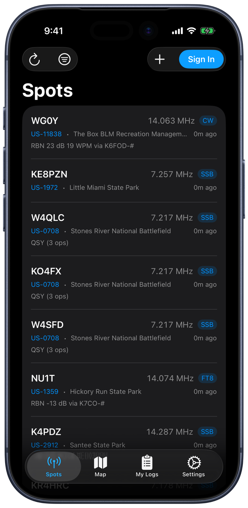
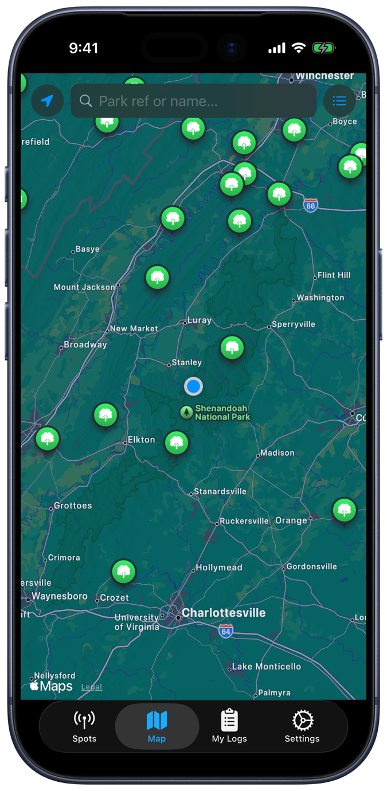
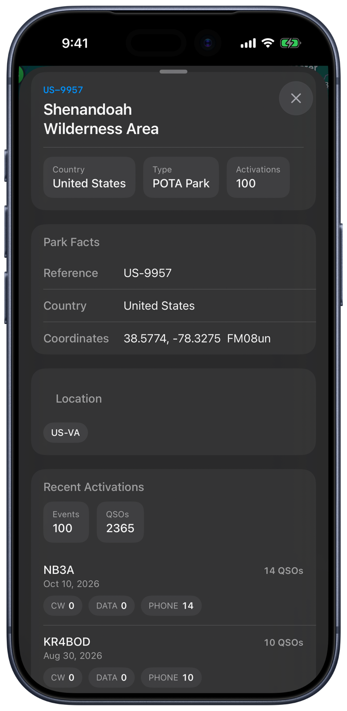
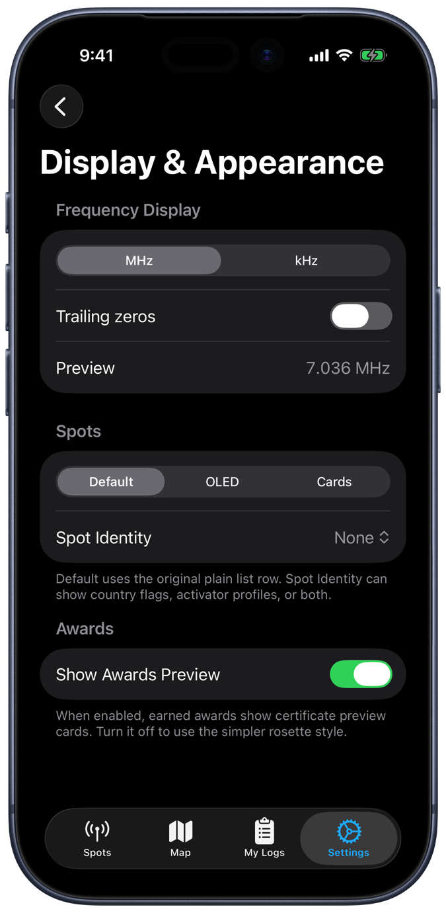

# POTALogger

An iPhone, iPad, and Mac app for [Parks on the Air](https://pota.app) (POTA). It shows live activator spots, maps the parks around you, and lets you post spots and track award progress with your pota.app account.

It's built in SwiftUI, and VoiceOver support is a first-class goal rather than an afterthought.

<table>
  <tr>
    <td></td>
    <td></td>
    <td></td>
    <td></td>
  </tr>
</table>

## Features

### Spots
- Live spots from the pota.app API, with pull to refresh and an optional auto refresh interval.
- Filter by band and mode, and change the sort order.
- Three list styles: Default, OLED (compact), and Cards. Rows can also show country flags, activator profile photos, or both.
- Frequencies in MHz or kHz, with or without trailing zeros.

### Map
- POTA parks around your location, from the full park list (about 50,000 parks) cached on device.
- Search by park reference or name, and switch between the map and a list.
- Tap a park for its details: location, grid square, and recent activations with QSO counts by mode.
- Filters for parks you've activated or hunted, once you sign in. Long-press the Map tab to switch between them.

### With a pota.app account
- Sign in with your existing pota.app account.
- Post spots, including self-spots. If you're offline, the app offers to relay the spot by text message through [APspot](https://apspot.radio).
- Award progress (parks, early and late shift, DX entities, US states, park-to-park, repeat offender, and more), your earned award certificates, and charts of your contacts by band.

### Siri and Shortcuts
Six App Shortcuts work from Siri or the Shortcuts app: QSO count, next award progress, repeat offender parks, live spots, filtered spots, and posting a spot.

### URL scheme
`potalog://` links open a specific tab or map filter, for use from Shortcuts or other apps:

| Link | Opens |
| --- | --- |
| `potalog://spots` | Spots tab |
| `potalog://map` | Map tab |
| `potalog://map?view=list` | Map tab, list view |
| `potalog://map?type=local` | Map tab, nearby parks |
| `potalog://map?type=activated` | Map tab, parks you've activated |
| `potalog://map?type=hunted` | Map tab, parks you've hunted |
| `potalog://settings` | Settings tab |

## Accessibility

The app is built and tested with VoiceOver.

- Park details on the map open as a real popover on iPhone, not a custom overlay, so VoiceOver plays the system popover sounds and treats it as modal.
- Map pins hidden behind the search bar and other floating controls are left out of VoiceOver, so focus doesn't land on a pin you can't see.
- Text uses the system text styles, so it follows your Dynamic Type size.

## Requirements

- Xcode 16 or later (developed with Xcode 27)
- iOS 18.2 or later, or macOS 14 or later through Mac Catalyst
- A pota.app account for posting spots and viewing awards. Browsing spots and the map works without one.

## Building

1. Clone the repo and open `POTALogger/POTALogger.xcodeproj` in Xcode.
2. Choose your own team under Signing & Capabilities. The project is set to the author's team, and the bundle ID needs to be one you can sign.
3. Select the POTALogger scheme and a simulator or device, then run.

There are no third-party dependencies.

## Project layout

```
POTALogger/
  POTALogger/              App source
    SpotsView.swift          Spots tab, filters, list styles
    MapView.swift            Map tab, search, park popovers
    POTAMKMapView.swift      MapKit wrapper and VoiceOver handling for pins
    ParkDetailView.swift     Park details and recent activations
    AwardsView.swift         Award progress, certificates, band charts
    AddSpotView.swift        Posting a spot, with the APspot SMS fallback
    AuthManager.swift        pota.app sign-in
    ParkIndex.swift          On-device park list
    AppIntents.swift         Siri and Shortcuts
    AppRouter.swift          Tabs and potalog:// links
    SettingsView.swift       Settings
  POTALoggerTests/         Unit tests
  POTALoggerUITests/       UI tests
docs/screenshots/          README screenshots (raw captures in raw/)
tools/                     Screenshot framing script
```

## Status

This is an ongoing personal project. It isn't on the App Store.

Unfinished parts:
- **My Logs** is still the Xcode template placeholder. It doesn't show your logbook yet.
- **Notifications** only asks for permission. The app doesn't send any notifications yet.

## Screenshots

The images above are real simulator captures framed in Apple's iPhone 17 Pro bezel. To regenerate them after a UI change, see [tools/README.md](tools/README.md).

## Disclaimer

POTALogger is an independent project. It isn't affiliated with or endorsed by Parks on the Air.
